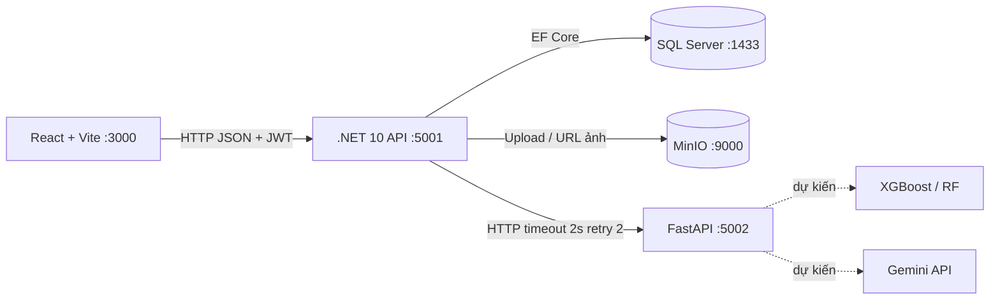

# Car Rental AI — Hệ thống Cho thuê Xe Thông minh

> Tối ưu giá thuê & tư vấn đặt xe bằng AI · Đồ án Chuyên đề tổng hợp .NET + DevOps + AI (10 tuần)

[](https://dotnet.microsoft.com)
[](https://vitejs.dev)
[](https://fastapi.tiangolo.com)
[](https://www.microsoft.com/sql-server)
[](https://docs.docker.com/compose/)

## Tổng quan

Code hiện tại: khách chọn xe và ngày thuê → React gọi .NET để báo giá/đặt xe → .NET gọi FastAPI rồi tính giá cuối. FastAPI mới trả giá gốc, chưa có model ML hoặc chatbot Gemini thật. Nếu gọi định giá lỗi sau timeout/retry, client .NET trả giá niêm yết với `IsFallback = true`; các kiểm tra nghiệp vụ đặt xe vẫn áp dụng.

| Thành phần | Công nghệ | Port |
|---|---|---|
| Backend | .NET 10, Clean Architecture + Modular Monolith | 5001 |
| AI Service | FastAPI Python độc lập; ML và Gemini mới là kế hoạch | 5002 |
| Frontend | React + Vite (phục vụ qua nginx) | 3000 |
| Database | SQL Server 2022 | 1433 |
| Object Storage | MinIO — lưu ảnh xe, chỉ nhận WebP | 9000 (API), 9001 (console) |

## Trạng thái hiện tại

Đối chiếu code local ngày 26/10/2026, gồm thay đổi chưa commit. "Đã có code" không có nghĩa đã kiểm thử hoặc nghiệm thu trên môi trường chạy thật.

| Hạng mục | Trạng thái |
|---|---|
| Auth (đăng ký, đăng nhập JWT, phân quyền Customer/Staff/Admin) | Đã có |
| Quản lý xe (CRUD, lọc, phân trang, upload/chọn ảnh chính/xóa ảnh WebP) | Đã có backend và trang quản trị; URL ảnh/casing UI còn cần đối chiếu |
| Đặt xe, báo giá, lịch đã đặt, xem/xác nhận/hủy | Đã có; create dùng transaction và khóa dòng xe chống trùng đồng thời, chặn hủy đơn đang thuê |
| Gọi AI định giá | Client đã có timeout 2s mỗi lần gọi, retry 2, fallback và test; FastAPI vẫn là stub |
| Test .NET | Có test giá, retry, correlation ID, validation/metadata và integration booking/ảnh/quan hệ payment; không chỉ có PricingCalculator |
| Thanh toán, nhận/trả xe, hợp đồng PDF | Chưa có API |
| Chatbot Gemini, báo cáo doanh thu | Có UI; chưa có backend proxy chat/API báo cáo, FastAPI chat chỉ echo |

Nguồn tra cứu: [API theo code](docs/api-contract.md), [kiến trúc](docs/architecture.md), [backlog theo chức năng](docs/jira-backlog-theo-chuc-nang.md). [Kế hoạch tuần](docs/weekly-plan.md) mô tả mục tiêu triển khai, không phải trạng thái hoàn thành.

## Kiến trúc

**Nhãn ngắn:** Clean Architecture, Modular Monolith · **Khung 3 cột:** 1.2 Clean/Onion + 2.4 Client-Server (backend là 2.2 Modular Monolith) + 3.1 Request-Response



- Code: Clean Architecture 5 project, bên trong Domain/Application chia module Cars / Bookings / Customers.
- Hệ thống: Client-Server — React là client, .NET API và FastAPI là server.
- Tích hợp .NET ↔ AI: Request-Response đồng bộ (HTTP), không dùng queue/broker — xem [docs/decisions.md](docs/decisions.md) (ADR-003).

Chi tiết: [docs/architecture.md](docs/architecture.md)

## Công nghệ

| Lớp | Tech | Ghi chú |
|---|---|---|
| Backend | .NET 10, EF Core, JWT | Clean Arch 5 project, Modular Monolith |
| AI | FastAPI + Pydantic; ML/Gemini chưa tích hợp | 3 endpoint: `/health`, `/predict-price`, `/chat` |
| Frontend | React + Vite | Gọi API qua JWT |
| DB | SQL Server | 6 bảng: Customer, Car, CarImage, Booking, Payment, ReturnRecord |
| Lưu trữ | MinIO | Bucket `car-rental`, ảnh xe định dạng WebP |
| DevOps | Docker Compose, GitHub Actions | CI build và test trên PR; CD dự kiến Railway/Render |

## Cấu trúc repo

```
CarRental.slnx
├── src/CarRental.Domain/           # Module: Cars / Bookings / Customers / Common
├── src/CarRental.Application/      # Module: Cars / Bookings / Customers
├── src/CarRental.Infrastructure/   # EF Core, MinIO, HttpClient gọi AI
├── src/CarRental.API/              # Composition root, Controllers
├── tests/CarRental.Tests/
├── ai-service/                     # FastAPI — service độc lập (Năng)
├── frontend/                       # React + Vite (Việt Anh)
├── docs/
│   ├── api-contract.md
│   ├── architecture.md
│   ├── decisions.md
│   ├── erd.dbml
│   ├── weekly-plan.md
│   └── jira-backlog-theo-chuc-nang.md
├── .github/workflows/ci.yml
├── .env.example
└── docker-compose.yml
```

Quy tắc: Domain không tham chiếu gì. Application chỉ tham chiếu Domain. Mỗi module nghiệp vụ nằm trong folder `Modules/<TênModule>` — chỉ là quy ước đặt folder.

## Phân công

| TV | Họ tên | Vai trò |
|---|---|---|
| A | Nguyễn Vũ Dũng (nhóm trưởng) | Kiến trúc, ERD, API contract, board, review PR |
| B | Đỗ Anh Tuấn | Backend nghiệp vụ (Auth, Car, Booking, Payment, PDF) |
| C | Nguyễn Minh Năng | AI Service FastAPI |
| D | Lê Việt Anh | Frontend React |
| E | Vũ Duy Tiến | Docker Compose, CI/CD, deploy |

## Bắt đầu nhanh

Yêu cầu: Docker Desktop. Chạy backend riêng cần thêm .NET 10 SDK.

```bash
git clone https://github.com/nguyenvudung365-commits/car-rental-ai.git
cd car-rental-ai

# Tạo file môi trường rồi điền giá trị thật (không commit .env)
cp .env.example .env

# Chạy full stack
docker compose up --build
```

Ở môi trường Development, API tự áp migration khi khởi động nên không cần chạy `dotnet ef` thủ công.

Chạy backend riêng (cần SQL Server đang chạy và `ConnectionStrings__Default` trỏ tới đó):

```bash
dotnet build CarRental.slnx
dotnet run --project src/CarRental.API
```

API không khởi động nếu `Jwt:Key` thiếu, ngắn hơn 32 ký tự, là khóa mẫu hoặc bắt đầu bằng `CHANGE_ME`. Đặt khóa bằng biến môi trường hoặc user-secrets (chỉ dùng chuỗi ngẫu nhiên của riêng bạn):

```bash
export Jwt__Key="<chuỗi ngẫu nhiên >= 32 ký tự>"
# hoặc
dotnet user-secrets set "Jwt:Key" "<chuỗi ngẫu nhiên >= 32 ký tự>" --project src/CarRental.API
```

| Dịch vụ | Địa chỉ |
|---|---|
| Frontend | http://localhost:3000 |
| API health | http://localhost:5001/health |
| OpenAPI JSON (Development) | http://localhost:5001/openapi/v1.json |
| AI Service docs | http://localhost:5002/docs |
| MinIO console | http://localhost:9001 |

### Biến môi trường

Khai báo trong `.env` (không commit). Mẫu đầy đủ ở [.env.example](.env.example).

| Biến | Ý nghĩa |
|---|---|
| `DB_NAME`, `DB_USER`, `DB_PASSWORD` | Kết nối SQL Server |
| `JWT_KEY` | Khóa ký JWT, tối thiểu 32 ký tự; API không khởi động nếu thiếu/ngắn/là khóa mẫu hoặc bắt đầu bằng `CHANGE_ME` |
| `GEMINI_API_KEY` | Khóa Gemini cho chatbot |
| `AI_TIMEOUT_SECONDS`, `AI_RETRY_COUNT` | Timeout và số lần retry khi gọi AI (mặc định 2 và 2) |
| `MINIO_ACCESS_KEY`, `MINIO_SECRET_KEY`, `MINIO_BUCKET` | Truy cập MinIO |
| `MINIO_PUBLIC_URL` | Compose truyền vào settings; storage hiện trả object key, chưa tự ghép thành URL ảnh |
| `MINIO_HOST_PORT`, `MINIO_CONSOLE_PORT` | Port MinIO trên máy host (mặc định 9000 và 9001) |
| `SEED_ADMIN_EMAIL`, `SEED_ADMIN_PASSWORD`, `SEED_STAFF_EMAIL`, `SEED_STAFF_PASSWORD` | Tạo tài khoản dev khi chưa có email/điện thoại; bỏ qua mật khẩu mẫu hoặc dưới 8 ký tự |

`.env` được Docker Compose nạp để nội suy cấu hình, không được .NET tự đọc khi chạy riêng. Các biến mẫu `DB_HOST`, `DB_PORT`, `AI_SERVICE_URL`, `MINIO_ENDPOINT`, `CORS_ORIGINS`, `LOG_LEVEL` hiện không được Compose/code tiêu thụ trực tiếp; không coi việc đổi chúng là đã đổi cấu hình ứng dụng. CORS .NET đang cố định `http://localhost:3000`; URL AI trong Compose là `http://ai:5002`.

### Lỗi thường gặp

- **Port 9000/9001 đã bị chiếm** (ví dụ container MinIO của dự án khác): đặt `MINIO_HOST_PORT=9100`, `MINIO_CONSOLE_PORT=9101` và `MINIO_PUBLIC_URL=http://localhost:9100` trong `.env`.
- **`npm run build` lỗi segfault trên Node 22.12.0**: build frontend qua Docker (`docker compose build frontend`) hoặc dùng Node 20.
- **Tài khoản Admin/Staff**: đăng ký luôn tạo Customer; khi chạy Development có thể điền biến `SEED_*` ở trên để tạo tài khoản dev (1 = Customer, 2 = Staff, 3 = Admin).

## Tài liệu

- [API Contract](docs/api-contract.md) — endpoint, mã lỗi, ví dụ request/response
- [Architecture](docs/architecture.md) — kiến trúc đã chốt
- [Decisions & Phân rã chức năng](docs/decisions.md) — lịch sử ADR và phạm vi sản phẩm dự kiến
- [ERD](docs/erd.dbml) — 6 bảng
- [Kế hoạch theo tuần](docs/weekly-plan.md) — phân công và tiêu chí nghiệm thu W1–W10
- [Backlog theo chức năng](docs/jira-backlog-theo-chuc-nang.md) — bản backlog chính, trạng thái code local không thay cho nghiệm thu Jira
- [Quy trình Sprint](docs/sprint-backlog-workflow.md) — refinement, review, kiểm thử và nghiệm thu

## Quy tắc giá

```
FinalPricePerDay = COALESCE(OverridePrice, PredictedPrice, Car.BasePricePerDay)
Giới hạn [400.000đ, 1.500.000đ] / ngày
```

Khi hết lượt gọi AI mà không nhận được giá hợp lệ, client trả `BasePricePerDay` trong trường giá dự đoán cùng `IsFallback = true`; booking lưu lại giá này và correlation ID. `OverridePrice` vẫn ưu tiên cao nhất và giá cuối vẫn bị clamp. Timeout là 2 giây mỗi lần, tối đa 3 lần gọi với backoff 200/400 ms, không phải tổng thời gian 2 giây.

Stub FastAPI hiện trả HTTP 200 với `model_used = "stub_fallback"`; client chỉ đọc giá nên trường hợp này vẫn có `IsFallback = false`. Chi tiết schema và các điểm AI chưa nối: [API contract](docs/api-contract.md#5-net--fastapi).

## Nguồn Tài Liệu

`README.md` giữ hiện trạng tổng quan; `docs/architecture.md` là bản đồ code; `docs/api-contract.md` giữ contract hiện tại; EF migrations giữ schema thực thi; `docs/erd.dbml` minh họa schema; `docs/decisions.md` giữ lịch sử quyết định. Kế hoạch và backlog là công việc dự kiến, không phải bằng chứng đã hoàn thành.

Ngày 26/10/2026 bỏ hai hướng dẫn Jira cũ (`scrum-jira-backlog.md`, `jira-project-management-guide.md`) vì trùng và khác key/lịch của backlog chính. Bỏ DDL viết tay `erd.sql` vì sai tên bảng, enum và quan hệ Payment; dùng EF migrations thay thế, không tạo lại schema độc lập.

## Quy trình Git

`feature/*` từ `develop` → Pull Request → 1 approval → Squash merge. Không push thẳng vào `main` / `develop`.

Không commit `.env`, khóa API hoặc chuỗi kết nối.
