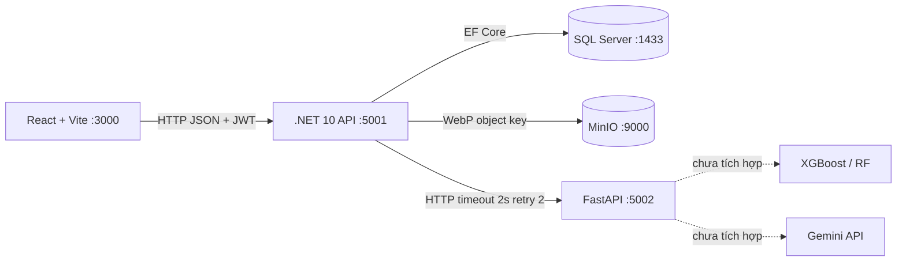

# Kiến trúc hệ thống — Car Rental AI

> Bản đồ implementation đối chiếu code local ngày 26/10/2026, gồm thay đổi chưa commit. Lịch sử quyết định: [decisions.md](decisions.md); contract hiện tại: [api-contract.md](api-contract.md).

## 1. Ba tầng kiến trúc

| Tầng | Câu hỏi | Trả lời của đồ án |
|---|---|---|
| Code architecture | Code tổ chức thế nào trong .NET? | **Clean Architecture + Modular Monolith** |
| System architecture | Hệ thống gồm những service nào? | **Client-Server** |
| Integration architecture | .NET gọi AI bằng gì? | **Request-Response (HTTP sync)** |

Ánh xạ với ảnh tổng quan kiến trúc: **1.2 Clean/Onion + 2.4 Client-Server (bên trong 2.2) + 3.1 Request-Response**.

## 2. System architecture — Client-Server



| Thành phần | Port | Tech | Phụ trách |
|---|---|---|---|
| Frontend | 3000 | React + Vite | Lê Việt Anh |
| Backend .NET | 5001 | .NET 10, Clean Architecture, Modular Monolith | Nguyễn Vũ Dũng + Đỗ Anh Tuấn |
| AI Service | 5002 | FastAPI stub; XGBoost/RF và Gemini chưa tích hợp | Nguyễn Minh Năng |
| Database | 1433 | SQL Server | Nguyễn Vũ Dũng |
| Object storage | 9000/9001 | MinIO API/console | Backend + DevOps |
| DevOps | — | Docker Compose, GitHub Actions | Vũ Duy Tiến |

> Lưu ý: Backend .NET là **MỘT khối deploy duy nhất (monolith)** nhưng bên trong chia module rõ (mục 4). AI Service là **service độc lập ngoài monolith** để scale riêng phần AI — đây là điểm khác biệt khi phản biện.

## 3. Integration architecture (.NET ↔ AI) — ĐÃ CHỐT

- **Cơ chế:** HTTP request-response đồng bộ.
- **Timeout:** mặc định 2 giây mỗi lần; retry 2 lần (tối đa 3 lần gọi), backoff 200/400 ms. Tổng thời gian có thể vượt 2 giây.
- **Fallback:** hết lượt gọi không có giá → trả `Car.BasePricePerDay` cùng `IsFallback = true`; giá cuối vẫn ưu tiên override và clamp.
- **Correlation ID:** booking tự sinh ID, truyền qua `PredictPriceRequest` vào header `X-Correlation-Id` và lưu cùng đơn. Header request/response ngoài có thể là ID khác.
- **Hiện trạng AI:** `/predict-price` trả giá gốc, chưa dùng ngày bắt đầu/thời hạn thuê dù .NET đã gửi. `/chat` chỉ echo nếu có key, chưa gọi Gemini. Stub định giá trả 200 nên .NET hiện gắn `IsFallback = false`.
- **Không dùng** RabbitMQ/Kafka, MassTransit/Wolverine (chỉ có nghĩa với bất đồng bộ).

## 4. Code architecture — Clean Architecture + Modular Monolith (.NET 10)

Backend là Modular Monolith đặt trong khung Clean Architecture (5 project). Quy tắc phụ thuộc: Domain không tham chiếu gì.

```
CarRental.slnx
├── src/CarRental.Domain          → KHÔNG tham chiếu gì
├── src/CarRental.Application     → chỉ tham chiếu Domain
├── src/CarRental.Infrastructure  → tham chiếu Application
├── src/CarRental.API             → tham chiếu Application + Infrastructure
└── tests/CarRental.Tests
```

Tổ chức theo module nghiệp vụ (chỉ là quy ước đặt folder, không đổi kiến trúc):

```
src/CarRental.Domain/
├── Modules/Cars/          # Car, CarImage
├── Modules/Bookings/      # Booking, Payment, ReturnRecord
├── Modules/Customers/     # Customer
└── Common/                # BaseEntity, Enums

src/CarRental.Application/
├── Modules/Cars/
├── Modules/Bookings/
└── Modules/Customers/
```

## 5. Quy tắc giá

```
FinalPricePerDay = COALESCE(OverridePrice, PredictedPrice, Car.BasePricePerDay)
Chặn [400.000đ, 1.500.000đ] / ngày
```

## 6. Bảo mật & Liên kết

- Public: đăng ký/đăng nhập, danh sách/chi tiết xe và health. `PUT /api/auth/me` yêu cầu JWT; toàn bộ booking yêu cầu JWT. CRUD/ảnh xe và confirm booking cho Admin/Staff. Xem/hủy đơn của Customer được kiểm tra chủ sở hữu.
- Secret lấy từ cấu hình/biến môi trường. Compose nội suy `.env`; .NET chạy riêng cần environment hoặc user-secrets. Không suy ra branch protection hay GitHub Secrets đã cấu hình chỉ từ file trong repo.
- Chi tiết endpoint: [api-contract.md](api-contract.md) · ERD: [erd.dbml](erd.dbml) · Quyết định: [decisions.md](decisions.md)

## 7. Bản Đồ Code Và Ranh Giới Hiện Tại

| Phần | Nguồn chính | Hiện trạng |
|---|---|---|
| Composition root | `src/CarRental.API/Program.cs` | DI, JWT, CORS, JSON PascalCase, migrate/seed ở Development |
| Auth | `AuthController`, `CustomerService` | Register/login, cập nhật hồ sơ; JWT/BCrypt nằm ở Infrastructure |
| Xe/ảnh | `CarsController`, `CarService`, `MinioFileStorageService` | CRUD, lọc/phân trang, WebP, ảnh chính/xóa ảnh; DTO ảnh trả object key |
| Booking | `BookingsController`, `BookingService` | Create/estimate, lịch thuê, danh sách/chi tiết, confirm/cancel |
| Chống trùng | `CarRepository.LockForBookingAsync`, `BookingRepository.HasOverlapAsync`, `ApplicationDbContext.ExecuteInTransactionAsync` | Khóa dòng xe và check/save trong một transaction; AI được gọi trước transaction |
| Quy tắc giá | `Application/Common/PricingCalculator.cs` | Override → Predicted → Base, clamp 400.000–1.500.000 VNĐ/ngày |
| Client AI | `Infrastructure/Ai/AiPricingClient.cs` | HTTP, retry/backoff, fallback và header correlation |
| AI | `ai-service/main.py` | Ba endpoint stub; chưa có dataset, model, training hay test Python |
| Database | `ApplicationDbContext`, `Infrastructure/Migrations/` | Sáu bảng; Booking 1-N Payment, Booking 1-1 ReturnRecord; StaffId chưa có FK |
| Frontend | `frontend/src/App.jsx`, `pages/`, `components/ChatWidget.jsx` | Auth, xe, booking, trang quản trị; chat/return/report có UI nhưng chưa có API tương ứng |
| CI | `.github/workflows/ci.yml` | Restore/build/test .NET; chưa có job frontend/Python |

Chưa có controller payment, nhận/trả xe, PDF, báo cáo hoặc AI proxy. Không coi các entity/trang UI này là chức năng đã hoàn tất. Các lệch contract UI (đặc biệt ảnh và trạng thái trang trả xe) còn cần xử lý khi tích hợp.

Test .NET hiện gồm giá, retry/fallback, correlation ID/ownership, validation/metadata và integration booking/ảnh/quan hệ payment/soft-delete. Các integration test DB thử SQL Server LocalDB và `return` sớm nếu khởi tạo DB thất bại; test runner có thể vẫn hiển thị pass dù không thực hiện assertion. Cần xác nhận DB thực sự khả dụng khi dùng kết quả này làm bằng chứng nghiệm thu.

Frontend Axios dùng base URL tương đối `/api`. Vite dev proxy lấy `VITE_API_BASE_URL` (mặc định localhost:5001); nginx trong Docker proxy `/api` tới `http://api:5001`. Việc đặt biến runtime cho container nginx không tự thay đổi bundle đã build.
